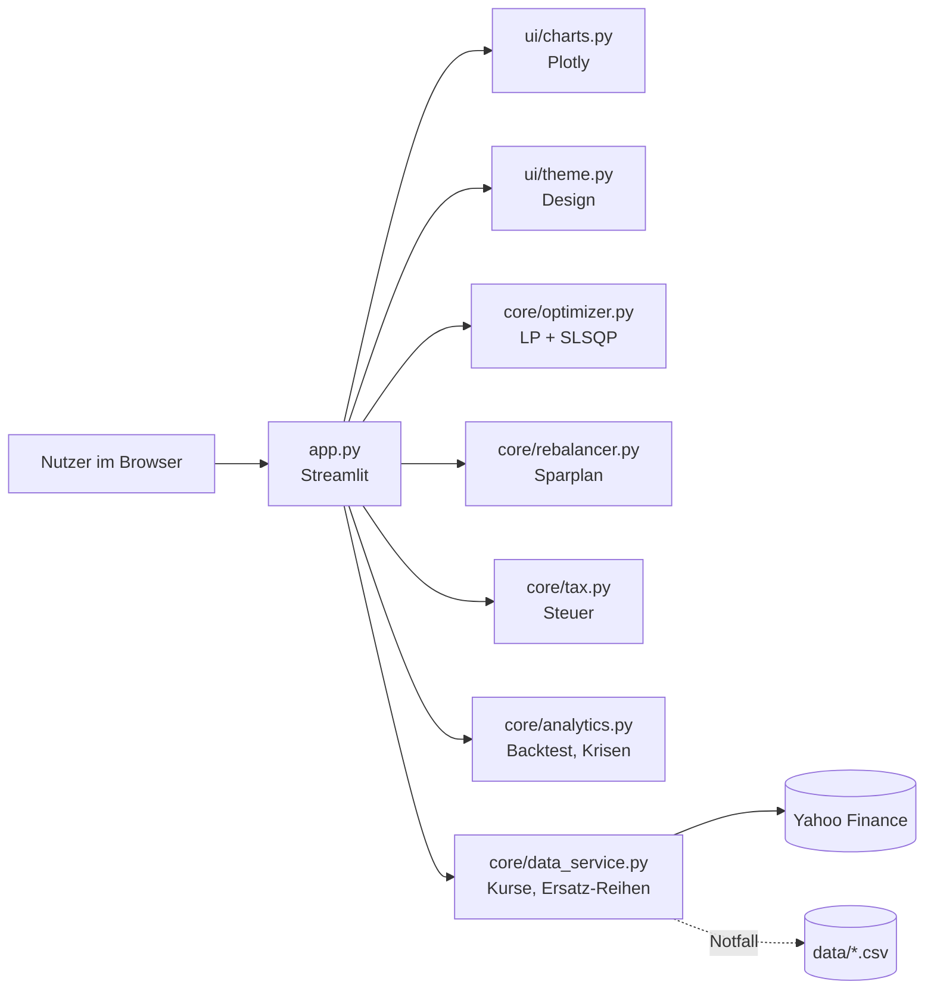

# Sparplan-Kompass

**Live-App:** https://sparplan-kompass.streamlit.app

Web-App für Privatanleger mit ETF-Sparplan: mehr Rendite pro Risiko, **ohne zu verkaufen**.
Die App berechnet, wie die monatliche Sparrate aufgeteilt werden muss, damit das Depot
eine selbst gewählte Schmerzgrenze einhält, und belegt das Ergebnis mit einem Backtest
auf echten Tageskursen.

## Funktionen

- **Dein Depot:** Bestand, Einstand und Kernpositionen je Titel; Bausteine, die zugekauft werden dürfen; 32 ETFs in sechs Gruppen plus beliebige eigene Yahoo-Kürzel (US-Werte in Euro umgerechnet)
- **Regeln:** Schmerzgrenze (Verlust an einem Schrecktag in % des Depots, 95 %-CVaR), maximale Positionsgröße, „nichts verkaufen“, Umbau-Zeitraum
- **Strategien:** Ausgewogen (Sharpe-Fokus, Standard) oder Extra vorsichtig 50/35/15 (Sharpe/CVaR/Varianz); im Rechenkern zusätzlich Rendite-Fokus und freie Mischung
- **Nachkaufen in Korrekturen:** Aktien-ETFs unter ihrer 50/100/200-Tage-Linie bekommen bis doppelt so viel Sparrate, Anleihen und Gold nie
- **Ergebnis:** feste Sparplan-Aufteilung, animierter Weg ins Ziel, Steuervergleich mit sofortigem Umschichten
- **Beweis:** Walk-Forward-Backtest gegen „einfach halten“, nur echte Kurse ab Börsenstart, frühestens ab Auflage des MSCI-World-ETFs; Risiko-Bilanz, Krisen- und Strategievergleich

## Aufbau



| Datei | Aufgabe |
|---|---|
| `app.py` | Oberfläche (Streamlit): Überblick, Dein Depot, Beweis |
| `ui/charts.py` | Grafiken (Plotly) |
| `ui/theme.py` | Design: CSS, Kopfbereich, Karten, Vergleichstabelle |
| `core/data_service.py` | Kurse laden, Datenfehler filtern, Ersatz-Reihen ansetzen, eigene Titel |
| `core/optimizer.py` | CVaR, vier Strategie-Bausteine und ihre Mischung, Kernpositionen |
| `core/rebalancer.py` | Sparplan-Fahrplan ohne Verkäufe |
| `core/tax.py` | Steuer und Gebühren beim Verkauf |
| `core/analytics.py` | Walk-Forward-Backtest, Kennzahlen, Krisen |
| `tests/test_core.py` | Tests für den Rechenkern |
| `data/sample_prices.csv` | ETF-Kurse als Notfall-Stand |
| `data/proxy_history.csv` | Ersatz-Reihen in Euro für die Zeit vor ETF-Auflage |

`core/` kennt weder Streamlit noch Plotly und lässt sich ohne Oberfläche testen.

## Lokal starten

```bash
pip install -r requirements.txt
```

```bash
streamlit run app.py
```

Tests:

```bash
python -m pytest
```

Kursdaten erneuern:

```bash
python scripts/update_sample.py
```

## Deployment

Streamlit Community Cloud, verbunden mit diesem Repository. Jeder Push auf `main`
aktualisiert die Live-App. Werden Module in `core/` geändert, die App danach unter
„Manage app“ → „Reboot app“ neu starten.

## Grenzen

- Historische Kurse sagen die Zukunft nicht voraus; die Voreinstellungen wurden auf denselben Kursen getestet, auf denen sie gezeigt werden.
- Standard: jeder Titel ab seinem echten Börsenstart; die gemeinsame Historie beginnt mit dem jüngsten Titel. Optional lassen sich Ersatz-Reihen bis 2000 zuschalten (teils nur Näherungen). Verglichen wird frühestens ab Auflage des Vergleichs-ETFs.
- Kursbewegungen während des Umbaus werden nicht prognostiziert.
- Vereinfachte Steuerrechnung. Keine Anlage- oder Steuerberatung.
